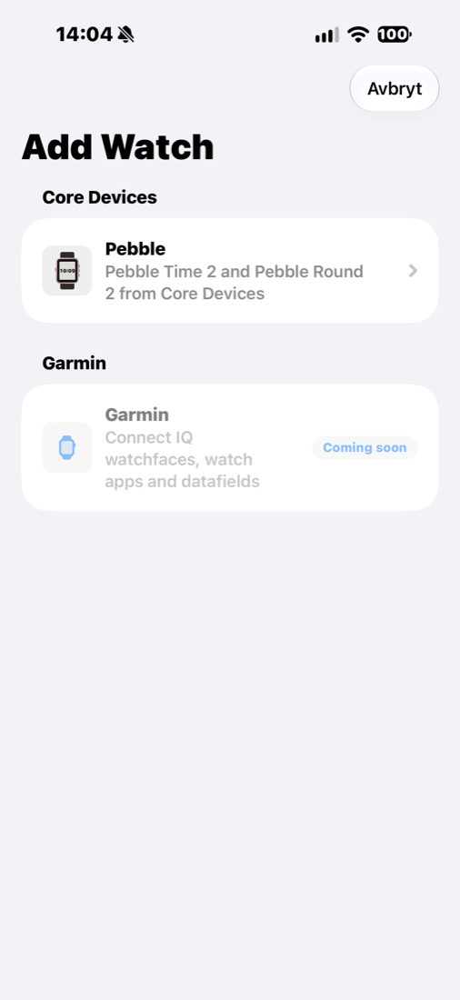

# GarminSmartwatchKit — experimental

> **Experimental.** Not tested on a Garmin yet. Don't rely on it for treatment decisions.

Garmin (Connect IQ) as a LoopKit `SmartwatchManager` plugin, for hosts such as [Trio](https://github.com/nightscout/Trio) and Loop.

It is derived from Trio's `GarminManager`, `GarminWatchState` and `GarminWatchSettings` (Trio contributors, MIT). The Connect IQ code is Trio's. What changed is where the data comes from: the plugin builds the Garmin watch state only from what it reads from its host (`SmartwatchManagerDelegate`) after `hostDataDidChange`, and keeps its devices and settings in its own `rawState`.

## What it does

- Sends glucose (with 2 h of history for SwissAlpine and the complication app, readings at least 5 minutes apart whatever the CGM), trend, delta, IOB, COB, last loop, temp or scheduled basal, ISF, eventual glucose, sensitivity ratio and target to:
  - a watchface or watch app: Trio, SwissAlpine, or Complication;
  - up to four datafields: Trio, SwissAlpine, LoopGraph (LoopGraph gets the 2 h history too; its app UUID is Tai's beta build).
- **Watch commands (off by default),** ported from [Tai](https://github.com/mountrcg/Tai) and its Garmin v1 message format: carbs, overrides and temp targets with *Enable Watch Commands*; bolus and meal bolus also need *Allow Bolus Commands*. The complication app sends them; the plugin answers only the app that asked and pushes it the preset list, switches and limits.
  - The plugin refuses a command older than 2 minutes (or more than 60 s ahead of the phone), a watch bolus within 6 minutes of the previous one, a repeated request ID (it gets the first answer again), and anything admitted before a switch was turned off.
  - One command app at a time (from mountrcg's Trio PR series): Complication when it is the watchface, otherwise Trio-WatchControls while commands are on. Only its commands run and only it gets the preset list; it is told when it becomes or stops being the command app (`ownerMode`), and changing it cancels pending commands.
  - **While commands are off (the default), the watch apps get only state**, as from Trio without these changes: no ownerMode notices and no preset pushes. A stand-down notice goes only to an app that was told it was active.
  - The host applies its own limits (maximum bolus, Trio's maximum IOB, maximum carbs) and rounds the bolus. Trio's 20 % recent-bolus check, which Tai also ran, isn't part of the host API, so it doesn't apply to these boluses.
- Settings: watches (chosen in Garmin Connect), watch apps, datafields, commands, display values and glucose colours.
- Logs go to the host's device log.

## Using it

- **Frameworks:** `GarminSmartwatchKit` and `GarminSmartwatchKitUI`, for hosts that link plugins (Trio).
- **Plugin bundle:** `GarminSmartwatchPlugin.loopplugin`, for hosts that load plugin bundles (Loop). Its `Info.plist` still sets `com.loopkit.Loop.PluginComingSoon`, but no host reads that key any more: Loop's Garmin and personal builds load the plugin and offer it in Add Watch like any watch.
- **Dependencies:** LoopKit and LoopKitUI (the `next-dev` API, as Loop and Trio since #1718 use) from the host's workspace, and Garmin's [Connect IQ SDK](https://github.com/garmin/connectiq-companion-app-sdk-ios) (Swift package).
- **Host app:** needs a URL scheme (Garmin Connect calls back with the chosen watches; the host passes that URL to `hostDidReceiveURL`) and `LSApplicationQueriesSchemes` for Garmin Connect (`gcm-ciq`), as Trio and Loop's Garmin and personal branches have.

The project is generated with [XcodeGen](https://github.com/yonaskolb/XcodeGen) from `project.yml`; the generated project is committed.

## Screenshot

Until 2026-11-09 Loop's personal build listed Garmin as coming soon, as below; it now offers Garmin like any watch:

## Licence

MIT. See `LICENSE`, which keeps Trio's copyright notice.
